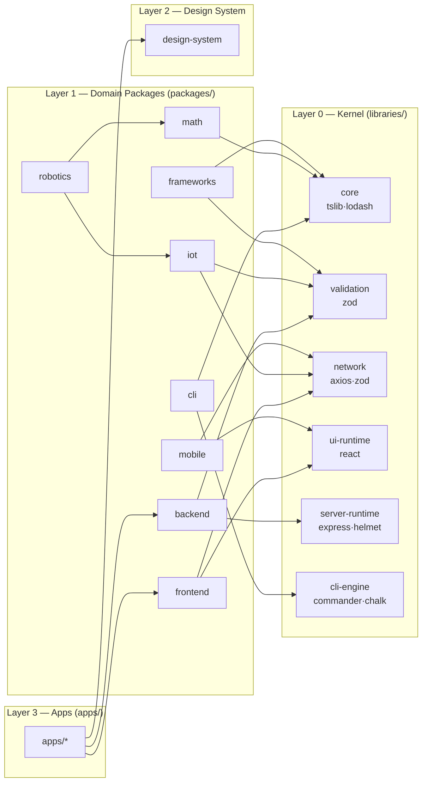

# AXIOLEDGER ($AXQ) — Monorepo

> **500,000 LOC · Hub & 4 Pillars · BSL-1.1 Core · MIT/Apache-2.0 SDKs**

The canonical monorepo for the **AXIOLEDGER** protocol — a high-performance, privacy-preserving, multi-chain financial operating system.
Managed with [Turborepo](https://turbo.build) + [pnpm workspaces](https://pnpm.io/workspaces).

---

## 📐 Architecture: 6-Layer Monorepo

The repository follows a **strict top-down dependency graph**. Higher layers may depend on lower ones; the reverse is never permitted.

```
axioledger-monorepo/                              (~500k LOC)
│
│  ╔══════════════════════════════════════════════════════════╗
│  ║  LAYER 0 — KERNEL  (libraries/)                         ║
│  ║  Foundation primitives. Zero internal cross-deps.        ║
│  ╠══════════════════════════════════════════════════════════╣
│  ║                                                          ║
├──║── libraries/                                             ║
│  ║   ├── core/            tslib · lodash                   ║
│  ║   ├── validation/      zod                              ║
│  ║   ├── network/         axios + zod                      ║
│  ║   ├── ui-runtime/      react (peer)                     ║
│  ║   ├── server-runtime/  express · helmet · cors          ║
│  ║   └── cli-engine/      commander · inquirer · chalk     ║
│  ╚══════════════════════════════════════════════════════════╝
│
│  ╔══════════════════════════════════════════════════════════╗
│  ║  LAYER 1 — DOMAIN PACKAGES  (packages/)                 ║
│  ║  Depend on libraries/*. Never depend on apps/            ║
│  ╠══════════════════════════════════════════════════════════╣
│  ║                                                          ║
├──║── packages/                                              ║
│  ║   │                                                      ║
│  ║   ├── ── New Architecture Packages ──                   ║
│  ║   ├── frontend/        ui-runtime + network             ║
│  ║   ├── backend/         server-runtime + validation      ║
│  ║   ├── cli/             cli-engine + core  [bin: axq]    ║
│  ║   ├── docs/            frontend + cli-engine            ║
│  ║   ├── css/             frontend (design tokens)         ║
│  ║   ├── testing/         core + server-runtime            ║
│  ║   ├── coverage/        cli-engine (quality gates)       ║
│  ║   ├── mobile/          ui-runtime + network             ║
│  ║   ├── frameworks/      core + validation (plugin sys)   ║
│  ║   ├── iot/             network + validation (MQTT)      ║
│  ║   ├── robotics/        math + iot (HAL / kinematics)    ║
│  ║   ├── math/            core (Vec/Mat/fixed-point)       ║
│  ║   │                                                      ║
│  ║   └── ── Domain SDKs (existing) ──                      ║
│  ║       ├── axq-sdk/         @axioledger/axq-sdk          ║
│  ║       ├── evm-interop/     ABI codegen + wagmi hooks    ║
│  ║       ├── ans-resolver/    ANS domain resolver SDK      ║
│  ║       ├── zkp-crypto-lib/  ZK proof Wasm bindings       ║
│  ║       ├── swift-bridge/    SWIFT ↔ on-chain bridge      ║
│  ║       ├── swift-adapter/   SWIFT Alliance SDK           ║
│  ║       ├── sdk-swift/       High-level SWIFT SDK         ║
│  ║       ├── sdk-internal/    Internal builders + events   ║
│  ║       ├── merchant-sdk/    Payment gateway SDK          ║
│  ║       ├── core-sdk/        Solana + EVM Web3 wrapper    ║
│  ║       ├── ui-kit/          Design system components     ║
│  ║       ├── types/           Shared TS interfaces         ║
│  ║       ├── config/          RPC endpoints + IDs          ║
│  ║       ├── db/              Database adapters            ║
│  ║       └── contracts/       EVM Solidity contracts       ║
│  ╚══════════════════════════════════════════════════════════╝
│
│  ╔══════════════════════════════════════════════════════════╗
│  ║  LAYER 2 — DESIGN SYSTEM  (design-system/)              ║
│  ║  Single source of truth for UI tokens, components        ║
│  ╠══════════════════════════════════════════════════════════╣
│  ║                                                          ║
├──║── design-system/                                         ║
│  ║   ├── src/components/   Button · Input · Modal · Chart  ║
│  ║   ├── tokens/           colors · typography · spacing   ║
│  ║   └── .storybook/       Interactive component docs      ║
│  ╚══════════════════════════════════════════════════════════╝
│
│  ╔══════════════════════════════════════════════════════════╗
│  ║  LAYER 3 — APPLICATIONS  (apps/)                        ║
│  ║  User-facing; may depend on any lower layer              ║
│  ╠══════════════════════════════════════════════════════════╣
│  ║                                                          ║
├──║── apps/                                                   ║
│  ║   ├── app-web/              Mobile-first PWA (main)     ║
│  ║   ├── axiopass-wallet/      Passkey smart wallet (PWA)  ║
│  ║   ├── axq-governance-ui/    DAO voting + treasury       ║
│  ║   ├── dao-portal/           DAO governance portal       ║
│  ║   ├── kpx-dex-frontend/     KPX DEX (gasless swaps)    ║
│  ║   ├── kyc-portal/           KYC officer dashboard       ║
│  ║   ├── merchant-portal/      Merchant management UI      ║
│  ║   ├── pay-portal/           Checkout / POS terminal     ║
│  ║   ├── id-fiat-gateway/      eKYC + Fiat on/off-ramp    ║
│  ║   ├── explorer-vnkrscan/    Block explorer + PoR        ║
│  ║   ├── swap-dex/             DEX AMM + analytics         ║
│  ║   ├── holding-admin-portal/ Holding admin (IP, capital) ║
│  ║   ├── sandbox-dashboard/    Developer + school sandbox  ║
│  ║   └── digital-twin-engine/  Digital twin / AI Labs      ║
│  ╚══════════════════════════════════════════════════════════╝
│
│  ╔══════════════════════════════════════════════════════════╗
│  ║  LAYER 4 — PROTOCOL NODES  (core-nodes/)                ║
│  ║  Validator + sequencer — FFI bindings, non-JS stubs      ║
│  ╠══════════════════════════════════════════════════════════╣
│  ║                                                          ║
├──║── core-nodes/                                            ║
│  ║   ├── valiprecision-node/   VPX Oracle price daemon     ║
│  ║   └── sequentichain-node/   SQX L2 sequencer + rollup  ║
│  ╚══════════════════════════════════════════════════════════╝
│
│  ╔══════════════════════════════════════════════════════════╗
│  ║  LAYER 5 — ON-CHAIN  (smart-contracts/ + programs/)     ║
│  ║  Solidity/Foundry + Solana Anchor Rust                   ║
│  ╠══════════════════════════════════════════════════════════╣
│  ║                                                          ║
├──║── smart-contracts/                                       ║
│  ║   ├── axioledger-system/    $AXQ governance + DAO       ║
│  ║   ├── ans-registry/         ANS domain registry         ║
│  ║   ├── kpx-liquidity/        AMM router + LP pools       ║
│  ║   └── vrq-circuits/         ZK circuits + passkey       ║
│  ║                                                          ║
├──║── programs/   (Solana Anchor)                            ║
│  ║   ├── VNKR-amm-swap/        x*y=k AMM with fee tiers   ║
│  ║   ├── VNKR-mint-governance/ Controlled token minting    ║
│  ║   ├── VNKR-p2p-escrow/      P2P fiat↔token escrow      ║
│  ║   ├── VNKR-swift-bridge/    SWIFT ↔ Solana bridge      ║
│  ║   └── VNKR-treasury-rbs/    DAO treasury + RBS          ║
│  ╚══════════════════════════════════════════════════════════╝
│
│  ┌──────────────────────────────────────────────────────────┐
│  │  SERVICES  (services/)  — Backend microservices           │
│  ├──────────────────────────────────────────────────────────┤
├──┤  services/                                                │
│  │  ├── api-gateway/          Auth · rate-limit · audit log │
│  │  ├── fiat-connector-api/   Bank webhook · Fiat matching  │
│  │  ├── swift-gateway/        SWIFT MGW proxy · LAU auth    │
│  │  ├── swift-chain-bridge/   Blockchain relayer            │
│  │  ├── swift-server/         SWIFT server binary / bin     │
│  │  ├── indexer-subgraph/     Helius/Subgraph indexer       │
│  │  ├── otc-liquidity-engine/ OTC institutional liquidity   │
│  │  ├── role-engine/          RBAC / on-chain roles         │
│  │  ├── mock-mgw/             Mock SWIFT MGW (dev/test)     │
│  │  └── dune-alert-bots/      Telegram / Discord analytics  │
│  └──────────────────────────────────────────────────────────┘
│
│  ┌──────────────────────────────────────────────────────────┐
│  │  TOOLING  (tooling/)  — Build, deploy, scripts            │
│  ├──────────────────────────────────────────────────────────┤
├──┤  tooling/                                                 │
│  │  ├── deploy/               Docker · K8s · Nginx · Terraform │
│  │  ├── scripts/              localnet · brand apply · PKI  │
│  │  ├── ssl/                  TLS certificates              │
│  │  └── github-push.sh        CI release push script        │
│  └──────────────────────────────────────────────────────────┘
│
│  ┌──────────────────────────────────────────────────────────┐
│  │  TESTS  (tests/)  — Integration & E2E test suites         │
│  ├──────────────────────────────────────────────────────────┤
├──┤  tests/                                                   │
│  │  └── e2e/                  Playwright · Jest E2E suites  │
│  └──────────────────────────────────────────────────────────┘
│
│  ┌──────────────────────────────────────────────────────────┐
│  │  INFRA  (infra/)  — Platform configuration & docs         │
│  ├──────────────────────────────────────────────────────────┤
└──┤  infra/                                                   │
   │  ├── core/                 API · banking · genesis · SDK │
   │  ├── community/            Open-source ecosystem repo    │
   │  ├── asset/                Brand assets, icons, fonts    │
   │  ├── audit/                UI audit reports & screenshots│
   │  └── logs/                 Deployment / runtime logs     │
   └──────────────────────────────────────────────────────────┘
```

---

## 🏛️ 5-Organisation Governance

| Org | Pillar | Token | Scope |
|---|---|---|---|
| `axioledger` | Hub (Core) | `$AXQ` | Governance, DAO, Treasury, Genesis |
| `veraciphers` | Security & ZK-DID | `$VRQ` | ZK-Circuits, DID, Axiopass Wallet, Design System |
| `kinetoprotocol` | DeFi Liquidity | `$KPX` | AMM Router, Bridge, RWA Logic, DEX Frontend |
| `valiprecision` | Oracle Network | `$VPX` | Price Feeds, Consensus Engine, P2P Client |
| `sequentichain` | Scaling Layer | `$SQX` | L2 Execution, SVM Rollup, AF_XDP Bypass |

---

## 🧱 Dependency Graph (Kernel → Domain → Apps)



---

## 🚀 Quick Start

### Prerequisites

```bash
node >= 20.0.0
pnpm >= 9.0.0
foundry (forge, cast, anvil) — https://getfoundry.sh
```

### Install

```bash
git clone https://github.com/axioledger/axioledger-monorepo.git
cd axioledger-monorepo
pnpm install
```

### Build all

```bash
pnpm build
```

### Test all

```bash
pnpm test
pnpm test:e2e        # Jest E2E (tests/e2e/)
pnpm test:e2e:pw     # Playwright
```

### Localnet

```bash
pnpm localnet        # bash tooling/scripts/localnet-setup.sh
```

### Run a specific workspace

```bash
pnpm --filter kpx-dex-frontend dev
pnpm --filter @axioledger/axq-sdk build
pnpm --filter axioledger-system forge test
```

---

## 🗺️ 7-Phase Execution Roadmap

### Phase 1 — Ideation & Positioning ✅
- [x] Define Hub & 4 Pillars architecture
- [x] Allocate 500k LOC across 14 workspaces
- [x] Establish BSL-1.1 (core) / MIT (SDK) licensing strategy
- [x] Register 5 GitHub organisations + ANS namespaces

### Phase 2 — Planning & Architecture ✅
- [x] Turborepo monorepo scaffold (`turbo.json`, `pnpm-workspace.yaml`)
- [x] Tokenomics: 500B $AXQ allocation model
- [x] ANS domain plan: `.axq` `.vpx` `.sqx` `.kpx` `.vrq`
- [ ] Smart contract DAO architecture (Quadratic Voting + Guardian Council)

### Phase 3 — Roadmap & Governance 🔄
- [x] Parallel execution tracks (Foundation / DeFi / Scaling)
- [x] Milestone 1 (Localnet): docker-compose + cargo test
- [ ] DAO Contracts: Quadratic Voting, Time-Lock (7d), Escape Hatch
- [ ] Guardian Council (5 seats, 4/5 veto)

### Phase 4 — Building Infrastructure ✅
- [x] Design System published → `@veraciphers/axio-design-system@4.0.0`
- [x] `VRQPasskeyValidator` deployed → Sepolia
- [x] `KPXRouterGateway` CI pipeline → green
- [x] VPX Oracle node implemented + tested
- [ ] Internal PKI: Root CA + 5 Intermediate CAs for ANS domains
- [ ] RBAC/IAM: SysAdmin / Node Operator / Treasury Engine roles

### Phase 5 — Harvesting & Integration 🔄
- [x] `@axioledger/axq-sdk` v0.2.0 — real viem calls to AXQToken + ANSRegistry
- [x] `@axioledger/evm-interop` v0.2.0 — full ABI catalogue + wagmi hooks
- [x] `axq-governance-ui` — wired to AXQGovernance: propose / castVote / execute
- [x] `axiopass-wallet` — VRQPasskeyValidator install + P256 key extraction
- [ ] AMM liquidity pools + Emission Controller
- [ ] Cross-chain bridge (KPX ↔ SQX)
- [ ] RWA Treasury activation

### Phase 6 — Testing & SecOps ⏳
- [ ] `supply-chain-audit.yml` GitHub Actions
- [ ] GPG commit signing enforcement
- [ ] 100k TPS stress test on devnet

### Phase 7 — Success & Endgame 🏆
- [ ] > 600,000 TPS throughput
- [ ] < 100ms soft confirmation latency
- [ ] Nakamoto Coefficient > 50
- [ ] ZK-Proof user data protection: 100%
- [ ] Genesis Block mainnet + Upgrade Authority → DAO

---

## 💰 Tokenomics — 500B $AXQ

| Allocation | % | Amount |
|---|---|---|
| VPX Validator Subsidy | 25% | 125B $AXQ |
| R&D & Protocol Treasury | 30% | 150B $AXQ |
| RWA Backing Reserve | 15% | 75B $AXQ |
| Core Team (4-yr vest) | 12% | 60B $AXQ |
| Strategic Partners | 13% | 65B $AXQ |
| TGE / Public Liquidity | 5% | 25B $AXQ |

---

## 📋 Status Matrix

| Workspace | Status | CI | Testnet |
|---|---|---|---|
| `smart-contracts/axioledger-system` | 🔄 In Progress | — | — |
| `smart-contracts/vrq-circuits` | ✅ v1 on Sepolia | ✅ Green | ✅ Sepolia |
| `smart-contracts/kpx-liquidity` | ✅ v1 scaffold | ✅ Green | ⏳ Pending |
| `core-nodes/valiprecision-node` | ✅ v1 implemented | ✅ Green | ⏳ Pending |
| `core-nodes/sequentichain-node` | ❄️ Frozen (Phase 3) | — | — |
| `packages/axq-sdk` | ✅ v0.2.0 | ✅ Green | N/A |
| `packages/ans-resolver` | ✅ v1 — 85.7% cov. | ✅ Green | N/A |
| `packages/evm-interop` | ✅ v0.2.0 | — | N/A |
| `packages/zkp-crypto-lib` | 🔄 Scaffolded | — | — |
| `design-system` | ✅ v4.0.0 published | ✅ Green | N/A |
| `apps/kpx-dex-frontend` | ✅ Scaffold | 🔄 Running | — |
| `apps/axiopass-wallet` | ✅ v1 — VRQPasskey | — | — |
| `apps/axq-governance-ui` | ✅ v1 — AXQGov | — | — |

---

## 🔐 Security & Licensing

- **Core Protocol** (`smart-contracts/`, `core-nodes/`): [BSL 1.1](./LICENSE) — source-available, no production fork without commercial license
- **SDKs** (`packages/`, `libraries/`): MIT / Apache-2.0
- **Applications** (`apps/`): AGPL-3.0

Security vulnerabilities → [`SECURITY.md`](./SECURITY.md)

---

*Made with ⚡ by the AXIOLEDGER core team.*
